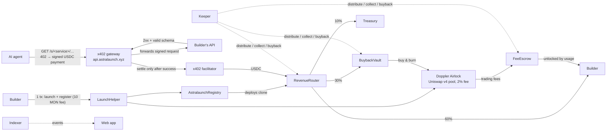

# Astralaunch

**Onchain rails for agent commerce: launch an API that AI agents pay per call (x402), and give it a token that is backed by real usage.**

Live on Monad mainnet: **[astralaunch.xyz](https://astralaunch.xyz)** · API and x402 gateway: **[api.astralaunch.xyz](https://api.astralaunch.xyz/health)**

---

## How it works

A builder pastes the link of an API they already run and sets a price per call. One transaction launches a token on Monad (Doppler, Uniswap v4 pool) and registers it with Astralaunch, which deploys a revenue router for it. Agents then call the API through the Astralaunch gateway and pay in USDC with x402; the gateway only settles a payment after the API answered successfully. Every paid call is split on-chain: most goes to the builder, part buys back and burns the token.



## Mainnet contracts (Monad, chain 143)

Astralaunch v2 (deploy outputs in [`packages/contracts/deployments/`](packages/contracts/deployments/)):

| Contract | Address | Source |
|---|---|---|
| AstralaunchRegistry | [`0x6B3A79C723AB69f8938C87209E1D9730c739e00c`](https://monadscan.com/address/0x6B3A79C723AB69f8938C87209E1D9730c739e00c) | verified |
| FeeEscrow | [`0xA070ad1387d525E4A180Bdb09B65FD4086858F15`](https://monadscan.com/address/0xA070ad1387d525E4A180Bdb09B65FD4086858F15) | verified |
| BuybackVault | [`0x394F1dcA6011C16BC6e70CA13F6F29767D92171E`](https://monadscan.com/address/0x394F1dcA6011C16BC6e70CA13F6F29767D92171E) | verified |
| PlatformFeeReceiver | [`0x2eFE45394d7578dC39c75d06Fe88722118F5Ec76`](https://monadscan.com/address/0x2eFE45394d7578dC39c75d06Fe88722118F5Ec76) | verified |
| RevenueRouter (implementation) | [`0x8530406130Bc3AF2C63Ee6616966913a4B92108F`](https://monadscan.com/address/0x8530406130Bc3AF2C63Ee6616966913a4B92108F) | verified |
| InitializerV1Adapter | [`0xe3C62514d9AE240A000e031FA67E64fCcd6Ac582`](https://monadscan.com/address/0xe3C62514d9AE240A000e031FA67E64fCcd6Ac582) | verified |
| LaunchHelper | [`0xc8D11D55cC5Bee0e01652A6812Fd727501018676`](https://monadscan.com/address/0xc8D11D55cC5Bee0e01652A6812Fd727501018676) | verified |
| Treasury (launch fee recipient) | [`0x888F0BDd45e460B4Af4A4a58D183Ea86CE9A351C`](https://monadscan.com/address/0x888F0BDd45e460B4Af4A4a58D183Ea86CE9A351C) | — |

All 7 Astralaunch contracts above are verified on Monadscan. Each token's revenue router (e.g. SIGHT
[`0x10bC…f240`](https://monadscan.com/address/0x10bC2220716738E8Aef57b9CC72101c190acf240), FEED
[`0xdBa0…fd3a`](https://monadscan.com/address/0xdBa0705cE9217B9E3dB296AF6a1810eB0467fd3a)) is a minimal Solady clone
(`LibClone.clone`, 44 bytes of bytecode) of the verified RevenueRouter implementation: every call is delegated to it,
so its logic is that contract's source.

External contracts used (sources in [`packages/shared/src/addresses.ts`](packages/shared/src/addresses.ts)): Doppler Airlock `0x660eAaEdEBc968f8f3694354FA8EC0b4c5Ba8D12`, Doppler V4 scheduled multicurve initializer `0xCe3099B2F07029b086E5e92a1573C5f5A3071783`, Uniswap v4 PoolManager `0x188d586Ddcf52439676Ca21A244753fA19F9Ea8e`, Universal Router `0x0D97Dc33264bfC1c226207428A79b26757fb9dc3`, Permit2 `0x000000000022D473030F116dDEE9F6B43aC78BA3`, USDC `0x754704Bc059F8C67012fEd69BC8A327a5aafb603`, WMON `0x3bd359C1119dA7Da1D913D1C4D2B7c461115433A`, Chainlink MON/USD `0xBcD78f76005B7515837af6b50c7C52BCf73822fb`.

## Demo services

Both are live and paid with x402 (0.05 USDC per call). Try them from the token page ("Try a sample call") or with any x402 client.

| Service | Token | Agent link | Sample call |
|---|---|---|---|
| **nullsight**: ranked X-style signals for a handle (sample data) | [$SIGHT](https://astralaunch.xyz/token/0x30Ae380593A04C14aBFa994969B718a78A6105aD) (USDC pair) | `https://api.astralaunch.xyz/s/nullsight/` | `GET /s/nullsight/signals?handle=monad` |
| **nullfeed**: latest 5 arXiv papers for a topic | [$FEED](https://astralaunch.xyz/token/0x2686619d5569AEbcdfeC774e8a2167dE78376dDf) (MON pair) | `https://api.astralaunch.xyz/s/nullfeed/` | `GET /s/nullfeed/digest?topic=agent%20payments` |

A call without payment returns `402` with the x402 requirements (`payTo` is the token's own RevenueRouter); the manifest is at `/api/services/<slug>/manifest`.

## Architecture

```
packages/contracts   Foundry (Solidity 0.8.24, via-IR): Registry, RevenueRouter, FeeEscrow, BuybackVault,
                     PlatformFeeReceiver, InitializerV1Adapter, LaunchHelper
packages/shared      economics constants, addresses, zod schemas, signed-message formats
apps/server          Hono: REST API, x402 gateway (/s/*), token image upload, creator-signed writes
apps/indexer         chain indexer (registry, routers, USDC transfers, Uniswap v4 swaps, holders) into Postgres
apps/keeper          scheduled on-chain jobs: distribute, collect trading fees, buyback-and-burn, forfeit
apps/web             Vite + React + Privy + viem: launch, swap (Universal Router + Permit2), discover, creator
apps/demo-services   the two demo APIs above
```

- **Contracts.** Each token gets a RevenueRouter clone; USDC sent to it (x402 settlements) is split by `distribute()`. Trading fees from the Doppler pool go to five beneficiaries; the escrowed part is released to the creator only as the token earns usage revenue.
- **Gateway.** Verifies the x402 payment, forwards the request (HMAC-signed, SSRF-checked, confined to the service's path prefix), checks the response (2xx, JSON schema if set) and only then asks the facilitator to settle.
- **Indexer.** Follows finalized blocks; market data (swaps, holders) is polled every 3 s, money-moving sets on the normal interval.
- **Keeper.** Permissionless calls with explicit gas (estimate × 1.1, Monad bills the gas limit); a collect is only sent when the fees are worth ≥ 5× its gas.
- **Web.** Launch in one transaction (LaunchHelper) plus one signature for the token details; swap through the Universal Router with Permit2; sample calls paid from the browser wallet (EIP-3009, no gas).

## Economics

| | Split |
|---|---|
| Pool trading fee | 2% of every trade |
| Trading fees → | creator 35% · FeeEscrow 20% · BuybackVault 10% · treasury 30% · Doppler 5% |
| Each paid API call (USDC) → | provider 60% · buyback & burn 30% · treasury 10% |
| FeeEscrow unlock | 20% of recorded usage revenue; unclaimed escrow goes to buyback after 365 days |
| Supply | 1,000,000,000 tokens: 85% in the pool, 15% vested to the creator (30-day cliff, 1 year) |
| Launch | 10 MON fee, at most 3 launches per wallet per 24 h; first 12 minutes: max 1% of supply per wallet |

The escrow unlock (20%) is kept below the non-provider share (40%), so paying your own API to unlock escrow always loses money. Usage-backed and trading-backed numbers are shown separately in the UI (UCR = usage coverage ratio).

## Run locally

Requirements: Node 22+, pnpm 9+, Foundry ≥ 1.8 (Monad support), Postgres 15+.

```bash
pnpm install
cp .env.example .env                      # fill in RPC, DATABASE_URL, … (see comments)
pnpm -F @astralaunch/server exec tsx src/db/migrate.ts
pnpm dev                                  # web :3000, server :3001, keeper, indexer

# contracts
cd packages/contracts && forge build && forge test -vv
```

A local Anvil fork of Monad mainnet (real Doppler, Uniswap v4, USDC) is used for end-to-end tests: see `astralaunch-anvil/` and `apps/web/scripts/fork-prepare.sh`. Production deployment (Docker Compose behind Coolify / Traefik) is described in [docs/DEPLOY-COOLIFY.md](docs/DEPLOY-COOLIFY.md) and [docs/MAINNET-RUNBOOK.md](docs/MAINNET-RUNBOOK.md).

## Tests

```bash
pnpm typecheck && pnpm test               # server, indexer, keeper, demo-services, web (vitest)
cd packages/contracts && forge test        # unit, fuzz, invariant tests
forge test --network monad --fork-url $MONAD_RPC_URL --match-path 'test/fork/*'   # against Monad mainnet state
```

Server tests run against an in-process Postgres (PGlite) with every migration applied.

## Security decisions

- **No custody.** No admin function can move router, escrow or vault balances to arbitrary addresses. Admin powers are limited to pausing new launches, capped settings and a two-step admin transfer; the treasury changes only through a 48 h timelock.
- **Never charge a failed call.** The gateway settles only after the upstream answered 2xx and passed the service's response schema; anything else returns an error and the buyer is not charged.
- **Creator-signed writes.** Service settings and token details are accepted only when signed by the token's on-chain creator, with replay protection (each message once, newer than the last). The token image and description are set once at launch and are final.
- **Gateway hardening.** SSRF checks (DNS resolved, private ranges blocked), requests confined to the service's path prefix, timeouts and size caps, HMAC-signed forwarding, encrypted API keys.
- **Trusted client IP.** Rate limits use only the address appended by our own reverse proxy (rightmost `X-Forwarded-For`), never client-supplied headers.
- **Uploads.** Token images: PNG / JPEG / WebP only (magic bytes and decoder must agree, never SVG), ≤ 2 MB, re-encoded to WebP with all metadata stripped, content-addressed.
- **Wallet safety.** Every transaction is simulated first and sent with explicit gas (estimate × 1.1); swaps show the minimum received and the 2% fee; the review says plainly when a long-lived Permit2 permission is granted ("Exact approvals only" keeps per-trade amounts).
- **Wash resistance.** Contracts count all USDC inflows; wash filtering (creator / platform payers) is display-only, and the escrow unlock math keeps self-payment unprofitable.

Design decisions and their reasons: [docs/decisions.md](docs/decisions.md). Operations: [docs/MAINNET-RUNBOOK.md](docs/MAINNET-RUNBOOK.md). How the product works for builders and agents: the in-app Docs page (`/docs`).

## License

[MIT](LICENSE)
